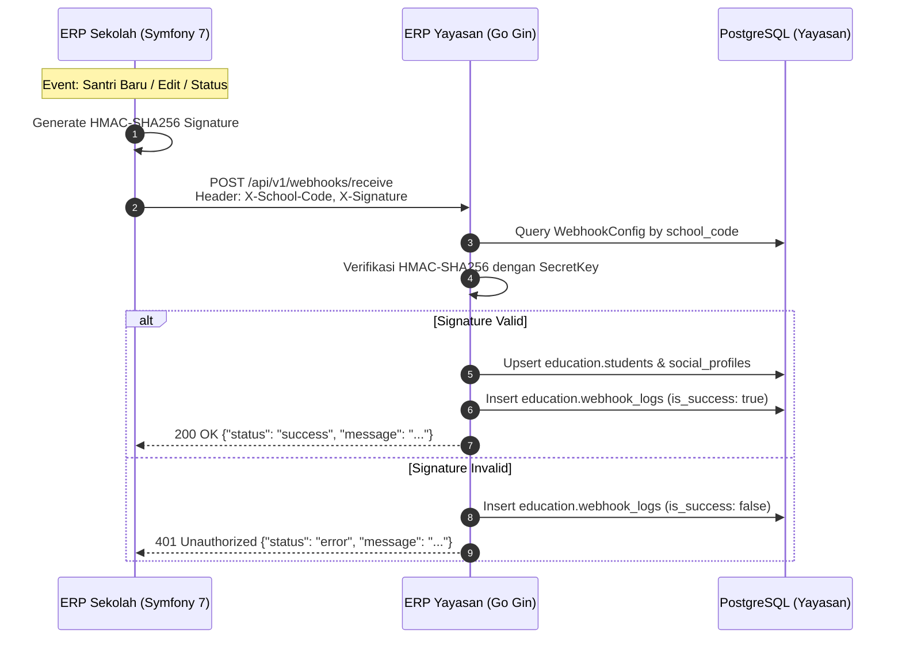

# Skill: Webhook Integration (Symfony 7 School ERP to Go Gin Foundation ERP)

## Overview & Architecture
Integrasi data antar **ERP Sekolah Cabang (Symfony 7 / PHP 8.2+)** dan **ERP Yayasan Induk (Go Gin / PostgreSQL)** menggunakan arsitektur **Outbound Ingest Webhook (HTTP POST REST)**.

Ketika terjadi perubahan data santri, profil sosial (yatim/dhuafa), atau pendaftaran di sekolah, ERP sekolah mengirimkan event webhook secara asinkron ke server yayasan. Server yayasan memvalidasi tanda tangan kriptografi (HMAC SHA-256), memperbarui master data yayasan, dan mencatat audit log.



---

## 1. Spesifikasi Endpoint Webhook Yayasan

- **URL Endpoint**: `POST /api/v1/webhooks/receive`
- **Content-Type**: `application/json`
- **Authentication**: HMAC-SHA256 Signature

### HTTP Headers Wajib
| Header | Tipe | Contoh Nilai | Keterangan |
| :--- | :--- | :--- | :--- |
| `Content-Type` | String | `application/json` | Format payload |
| `X-School-Code` | String | `SD_TUQ`, `MA_TUQ`, `MTS_TUQ` | Kode unik sekolah di yayasan |
| `X-Signature` | String | `a8b3...` (64 hex lowercase) | Hash HMAC SHA-256 dari raw JSON body menggunakan `SecretKey` |
| `X-Event-Type` | String | `student.created` *(opsional jika di payload sudah ada)* | Jenis event |

> [!NOTE]
> Server yayasan juga mengizinkan autentikasi langsung `X-Secret-Key: <secret_key>` atau `Authorization: Bearer <secret_key>` khusus untuk pengujian manual cURL / Postman.

---

## 2. Struktur Payload JSON

### A. Format Amplop (Envelope)
```json
{
  "event": "student.created",
  "timestamp": "2026-10-13T14:30:00Z",
  "school_code": "SD_TUQ",
  "data": { ... }
}
```

### B. Event Types yang Didukung

#### 1. `student.created` / `student.updated` / `student.upsert`
Digunakan untuk pendaftaran baru atau pembaruan profil santri dari cabang:
```json
{
  "event": "student.created",
  "school_code": "SD_TUQ",
  "data": {
    "erp_student_id": "SD24001",
    "school_code": "SD_TUQ",
    "name": "Muhammad Fatih Al-Ayyubi",
    "nik": "3201011204080001",
    "nisn": "0081234567",
    "gender": "L",
    "birth_date": "2008-05-15",
    "province_code": "32",
    "previous_school": "SDIT Nurul Fikri",
    "social_profile": {
      "economic_status": 1,
      "orphan_status": 1,
      "orphan_coverage_status": true,
      "parent_job_placement_code": "TUQ"
    },
    "enrollment": {
      "school_year": "2024/2025",
      "program": 1,
      "grade": "1",
      "classroom": "1-A",
      "status": 0
    }
  }
}
```

#### 2. `student.deleted`
Digunakan jika santri dibatalkan/dihapus dari sistem cabang:
```json
{
  "event": "student.deleted",
  "school_code": "SD_TUQ",
  "data": {
    "erp_student_id": "SD24001"
  }
}
```

---

## 3. Implementasi di ERP Sekolah (Symfony 7)

### A. Konfigurasi Environment (`.env`)
```env
YAYASAN_WEBHOOK_URL="http://localhost:8080/api/v1/webhooks/receive"
YAYASAN_SCHOOL_CODE="SD_TUQ"
YAYASAN_WEBHOOK_SECRET="6f3509b5d80143db5b723fd576f99ab2b70329fedc044cc0666ae8565e125caf"
```

### B. Service Pengirim Webhook (`src/Service/YayasanWebhookClient.php`)
```php
<?php

namespace App\Service;

use Symfony\Contracts\HttpClient\HttpClientInterface;
use Psr\Log\LoggerInterface;

class YayasanWebhookClient
{
    public function __construct(
        private HttpClientInterface $httpClient,
        private LoggerInterface $logger,
        private string $webhookUrl,
        private string $schoolCode,
        private string $webhookSecret
    ) {}

    public function sendEvent(string $eventType, array $data): bool
    {
        $payload = [
            'event' => $eventType,
            'timestamp' => (new \DateTimeImmutable())->format(\DateTimeInterface::RFC3339),
            'school_code' => $this->schoolCode,
            'data' => $data,
        ];

        $jsonPayload = json_encode($payload, JSON_UNESCAPED_UNICODE | JSON_UNESCAPED_SLASHES);
        $signature = hash_hmac('sha256', $jsonPayload, $this->webhookSecret);

        try {
            $response = $this->httpClient->request('POST', $this->webhookUrl, [
                'headers' => [
                    'Content-Type' => 'application/json',
                    'X-School-Code' => $this->schoolCode,
                    'X-Signature' => $signature,
                    'X-Event-Type' => $eventType,
                ],
                'body' => $jsonPayload,
                'timeout' => 5.0,
            ]);

            $statusCode = $response->getStatusCode();
            return $statusCode === 200;
        } catch (\Throwable $e) {
            $this->logger->error('Gagal mengirim webhook ke Yayasan: ' . $e->getMessage());
            return false;
        }
    }
}
```

### C. Pola Asinkron (Symfony Messenger Outbox Pattern)
Untuk performa tinggi di Symfony, disarankan menggunakan Messenger:
1. Dispatch message `SendWebhookMessage` di Doctrine Event Listener (`postPersist`, `postUpdate`).
2. Message handler mengeksekusi pengiriman HTTP request ke Yayasan di background worker (`php bin/console messenger:consume async`).

---

## 4. Pengujian via cURL / Terminal

Untuk menguji endpoint yayasan secara langsung dari command line:

```bash
SECRET="6f3509b5d80143db5b723fd576f99ab2b70329fedc044cc0666ae8565e125caf"
PAYLOAD='{"event":"student.created","school_code":"SD_TUQ","data":{"erp_student_id":"SD24099","name":"Ahmad Test","gender":"L","birth_date":"2010-01-01","province_code":"32"}}'

# Hitung Signature HMAC-SHA256
SIG=$(echo -n "$PAYLOAD" | openssl dgst -sha256 -hmac "$SECRET" | awk '{print $2}')

# Kirim Request
curl -i -X POST http://localhost:8080/api/v1/webhooks/receive \
  -H "Content-Type: application/json" \
  -H "X-School-Code: SD_TUQ" \
  -H "X-Signature: $SIG" \
  -d "$PAYLOAD"
```

---

## 5. Audit & Log Monitoring di Yayasan
Semua webhook yang masuk (baik yang berhasil maupun yang ditolak akibat invalid signature) tercatat di tabel `education.webhook_logs` dan dapat dipantau di frontend yayasan pada menu **Webhook Logs** (`/admin/webhook-logs`).
